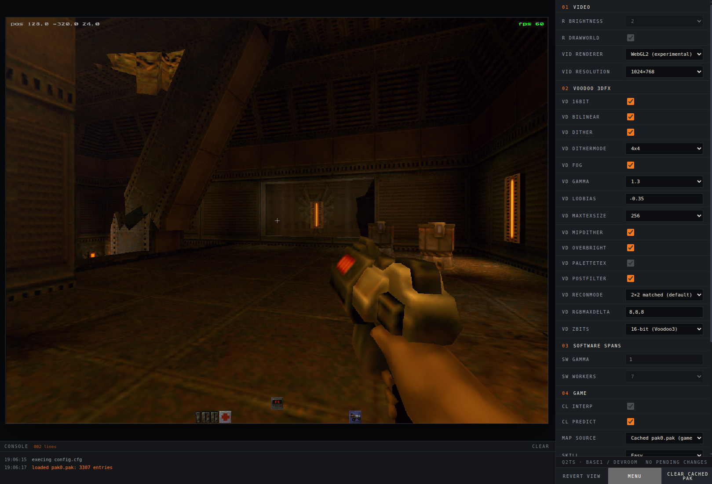

# Q2TS — Quake II in TypeScript



Software (`ref_soft`) + Voodoo 3 3000 (`ref_gl` look) port of Quake II that runs
in the browser. Yarn 4 monorepo with Turbo. See `BRAIN.md` for architecture
(the normative spec) and `apps/web/src/index.ts` for the current web entry.

## Prerequisites

- Node 22 (see `.nvmrc`, CI tests Node 20 + 22 per `.github/workflows/ci.yml`):
  ```bash
  nvm install   # reads .nvmrc
  nvm use
  node --version
  ```
  Without nvm, install Node 22 manually.
- Corepack + Yarn 4.9.2 (pinned via `packageManager` in `package.json`):
  ```bash
  corepack enable
  yarn --version  # 4.9.2
  ```

## Install

```bash
corepack enable
yarn install
```

## Run

All commands run from the repo root:

| Command | What it does |
| --- | --- |
| `yarn dev` | `turbo dev` — Vite HMR dev server for `apps/web` at http://localhost:5173 |
| `yarn build` | `turbo run build` — builds all workspaces (`tsup`, outputs `dist/`) |
| `yarn typecheck` | `turbo run typecheck` |
| `yarn lint` | `turbo run lint` |
| `yarn test` | `turbo run test` (vitest) |
| `yarn verify` | `turbo run typecheck lint test build` — the gate, must be green |
| `yarn golden -u` | update golden frames (review diff images) |
| `yarn bench` | perf ledger run |
| `yarn changeset` | add a changeset (required for any `packages/**` change) |
| `yarn cook <in.pak> [out.q2pkg]` | cook a pak into `.q2pkg` locally (never committed; out defaults to `<in>` with extension swapped) |

Per-package filtering (Turbo):

```bash
yarn turbo run build typecheck test --filter=...[origin/main]
```

## Web app (`apps/web`)

- Playable: `yarn dev` → http://localhost:5173. Click the canvas for
  pointer lock, then WASD + mouse, Space jump, E use, 1/2/3 weapons,
  click to shoot. HUD shows fps, position, weapon/ammo.
- No pak: explorable procedural devroom (real software renderer, analytic
  room collision). Drop your own `pak0.pak` (shareware, unmodified) anywhere
  on the page to boot base1: BSP collision, WAL textures, PCX palette,
  doors that open, exit trigger, shootable soldier/gunner placeholders.
  **Never commit `pak0.pak`.**
- At the end of Outer Base, enter the stationary elevator and press the
  switch at the back with E. The doors close and the elevator descends; at
  the bottom, the game pauses on an F1-style level results screen.
- Internal render res is 320×240, CSS-upscaled 2× (base1 spawn ≈10.8 ms/frame
  single-threaded; 640×480 native needs the M8.1 worker bands).
- Headless use (Node/tests) is via `bootWeb({ width, height, renderer, pak })`.

## Layout

```
apps/web        browser shell: canvas, HUD, pak drop zone, renderer switcher
apps/devtools   map/BSP inspector, lightmap viewer, frame differ
packages/*      engine: math, formats, bsp, sw-renderer, voodoo, game, server,
                client, host, sound, input, config, renderer-api, testkit
tools/asset-cooker  pak0.pak -> .q2pkg cooker CLI
tools/bench         headless perf runs
```

Dependency rules and frozen interfaces are defined in `BRAIN.md` §§4–6.

## CI

Push/PR runs `corepack enable && yarn install --immutable` then `yarn verify`
on Node 20 and 22.

## Troubleshooting

- Wrong Yarn version: run `corepack enable` first; repo pins `yarn@4.9.2`.
- Stale install: `yarn install`, then `yarn verify`.
- Asset-dependent tests skip when the `Q2_PAK` env var is absent.
